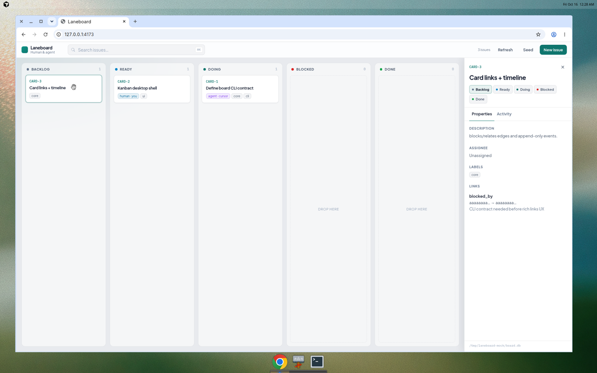

# Laneboard

Human-visible **Tauri desktop** kanban + agent-friendly **CLI**, sharing one SQLite store.

Agents move cards with `board … --json`. People use the native Board window on macOS and Windows.



Design: Linear / Plane–style board UX (dense cards, status color, detail drawer) — see [`docs/design-system.md`](docs/design-system.md).

## Direction

**Tauri is the primary desktop surface.** Native window first (tray / notifications / OS integration later). `board ui` remains a headless/dev browser fallback.

## What’s in the box

| Piece | Role |
|---|---|
| `crates/core` | Cards, links, append-only events, FTS5 search |
| `crates/cli` (`board`) | Agent CLI (+ optional embedded UI) |
| `apps/desktop` | **Tauri 2** desktop app |

Default DB: `<data_dir>/board/board.db` (`BOARD_DB` / `--db` to override).

## Desktop (macOS & Windows)

```bash
./scripts/dev-desktop.sh
# or: cd apps/desktop && npm i && npm run tauri dev
```

Release installers (build **on each OS**):

```bash
cd apps/desktop && npm run tauri build
# → apps/desktop/src-tauri/target/release/bundle/
```

CI: [`.github/workflows/desktop.yml`](.github/workflows/desktop.yml) builds macOS + Windows artifacts when this repo is on GitHub.

This environment also produces a Linux binary smoke build: `dist/board-desktop-linux-x64`.

## CLI (agents)

```bash
cargo run -p board -- seed
cargo run -p board -- ls --json
cargo run -p board -- move CARD-1 --to doing --actor agent --actor-name cursor --json
```

Windows CLI (prebuilt): [`dist/board-windows-x64.exe`](dist/board-windows-x64.exe)

```powershell
.\board-windows-x64.exe ls --json
.\board-windows-x64.exe ui   # fallback UI @ http://127.0.0.1:7841
```

## Data model (v0)

- **cards** — status, labels, human/agent assignee  
- **card_links** — blocks / relates / parent / …  
- **events** — append-only timeline  
- **cards_fts** — SQLite FTS5  

## Layout

```
crates/core          domain + SQLite
crates/cli           board binary
apps/desktop         Tauri app
docs/                design system + desktop notes
dist/                prebuilt CLI / smoke binaries
```
